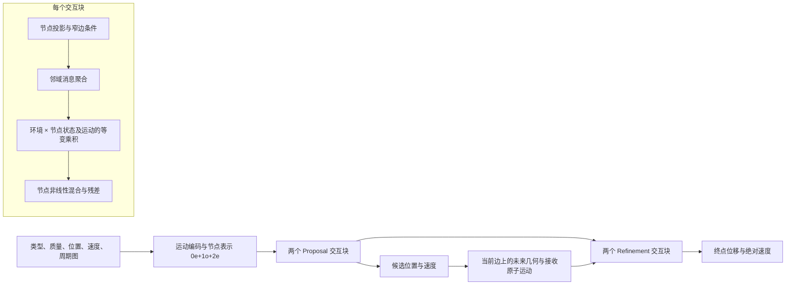

# 下一版代码设计：节点上的几何—运动交互

2026-11-20，设计原型 v0。实现分支：`research/phase-space-operator-20261120`。

这是一个具体网络候选及其可执行参考实现。**尚未训练，尚无准确性、长期物理或 GPU 加速结论。**
设计依据是[源码审查](../reports/implementation_audit_20261119/AUDIT.md)，不使用历史实验排名选择结构。
本轮不为原型另外创造论文名，也不把常用等变算子的组合声明成已成立的论文贡献。

## 1. 一项核心设计，而非多个附加模块

本候选把主要表示容量放在节点上，让聚合后的环境与原子的运动表示直接发生等变乘性交互。
边负责较窄的消息输运与条件生成，节点保留较宽的标量、向量、二阶表示。

要检验的学习假设是：**在有限时间相空间预测中，持续保留方向相关表示，并在每层显式耦合环境与运动，是否比先压缩为大块边不变量、再重建向量消息更有效。**
这不意味着现有网络无法表示这些关系，也不意味着增加二阶表示必然改善动力学。新的通道瓶颈、归一化和非线性同样可能限制学习。

整体继续使用当前的两层 Proposal、两层 Refinement、候选未来关系和两个读出头。
保留它们是为了限定本轮改动边界，并非根据旧结果认定未来反馈已经必要或有效。
这次替换完整传播算子及其表示；不能把未来任何收益单独归因于 l=2、聚合或某个归一化。

## 2. 表示、输入和对称性

节点表示固定为

\[
H_i=H_i^{(0e)}\oplus H_i^{(1o)}\oplus H_i^{(2e)},\qquad
H_i^{(l)}\in\mathbb R^{128\times(2l+1)}.
\]

每节点 1152 个表示分量；这不是 1152 个普通标量，也不是 1152 个参数。
仅保留自然宇称 0e/1o/2e，不包含 0o/1e/2o 或更高阶。不能称为完整的所有宇称高阶网络。
所有 CG 系数、表示线性映射与实球谐函数使用 e3nn；不自行实现旋转矩阵或复制未明确授权的 kernel。

输入仍为 Å、Å/fs、amu。先按每个系统减去质量加权 COM 速度，除以既有固定尺度 0.01 Å/fs，得到 u。
元素 embedding 与 log mass、速度模长的平滑基函数共同生成各阶系数。
速度编码采用

\[
t(u)=\frac{\|u\|^2}{1+\|u\|^2},\quad
b_k(u)=\exp[-K^2(t(u)-c_k)^2],\quad
Y_l\left(\frac{u}{\sqrt{1+\|u\|^2}}\right).
\]

这里使用不做单位向量归一化的 regular solid harmonics。零速度处一阶、二阶表示自然为零，导数有限；速度幅度没有被方向归一化丢弃。
有界坐标是数值参数化，不是物理频率或温度约束。它在极大速度下会压缩差异，这是需要保留的限制。

节点初始方向仍来自自身速度，邻域消息随后注入空间方向。几何信息不会在输入端凭空出现。
平移、O(3) 旋转/反射、原子置换、周期重映像按现有接口处理；COM 速度与输出修正保证匀速 boost 和线性动量语义。
没有角动量、能量或相空间体积守恒保证。

## 3. 完整交互块

### 3.1 预处理和窄边状态

节点分支的共同尺度为

\[
\rho(H)^2=\frac13\sum_{l=0}^2\frac{1}{128(2l+1)}\|H^{(l)}\|^2,
\quad \widetilde H^{(l)}=g_l H^{(l)}/\sqrt{\rho(H)^2+10^{-8}}.
\]

每阶/通道的 g 可学习，但不对 xyz 分量分别归一化，不跨原子做统计。原 H 保留在残差路径。

边状态宽度为 64。其更新输入包含：

- 两端节点标量的独立投影；这些投影在节点上先算，再索引到边。
- 上一层边状态的 RMS 归一化、当前/候选距离 RBF 与五个相对运动不变量。
- 两端各 4 通道的学习到的一阶/二阶投影，与当前/候选位置方向、相对运动基的内积，以及两端同阶相关量。

几何描述符为 18×4=72 维；逐边拼接宽度为 64+37+72=173。
边更新为一层非线性 MLP 分支，与原边状态相加后除以 sqrt(2)。
这些低维投影是有意设置的表达瓶颈，不是与旧的大维度几何拼接代数等价的加速。

### 3.2 消息输运

每层把 128 通道节点表示线性投影成 32 通道。
边网络生成五组、每组 32 个不变量系数：一组控制 sender 隐藏表示，四组控制当前/候选的几何与相对运动基。

\[
m_{ij}^{(l)}=a_{ij,0}\odot W_l\widetilde H_j^{(l)}
 +\sum_{b=1}^4 a_{ij,b}\odot B_{ij,b}^{(l)}.
\]

同组系数在 l=0/1/2 间共享，避免生成一整套逐边全通道张量积权重。
这是另一个明确的因子化限制，不等价于完全连接张量积。

\[
M_i^{(l)}=W_l^{up}\sum_j\frac{c(r_{ij}^{current})}{\alpha}m_{ij}^{(l)},\qquad
\alpha=\sqrt{\mathbb E_{i\in train}\sum_j c(r_{ij})^2}.
\]

alpha 仅由完整 TRAIN 缓存计算并冻结。它按独立消息的方差尺度设计，但真实消息相关，不能声称聚合后严格单位方差。
不再以每个输入节点的实际邻居权重和作分母。配位变化可影响聚合幅度，随后节点非线性仍会改变其尺度。
cutoff 在最终消息上显式乘一次；边 MLP bias 不会使截断外消息重新非零。

当前边的周期镜像身份在两阶段保持一致，不重建未来图。Quartz 4.5 Å，Water 6 Å；没有隐藏的 max-neighbors 截断。

### 3.3 节点上的几何—运动耦合

先将环境做带单位下限的共同 RMS 压缩：

\[
\overline M=M/\sqrt{1+\rho(M)^2}.
\]

单位下限具有具体作用：环境趋于零时，分支也平滑趋于零。若使用接近零的环境 RMS 作分母，会几乎抵消单条边的 cutoff，形成很窄的边界变化层。
这里不完全消除幅度，但大幅值会压缩；它也不是严格的动力学稳定性约束。

令 U_i 是同阶的元素条件化运动表示，计算

\[
A_i=(W_H\widetilde H_i+W_U U_i)/\sqrt2,\quad C_i=W_M\overline M_i,
\]

\[
P_i^{(l)}=\sum_{l_1,l_2\to l} w_{l_1l_2l}\odot
 [A_i^{(l_1)}\otimes C_i^{(l_2)}]_l.
\]

实际共 11 种允许的阶路径，通道内采用 `uuu` CG 乘积，前后通过节点线性层混合通道。
例如 2e×1o→1o 使二阶环境影响向量预测；1o×1o→0e/2e 将方向关联反馈到标量及二阶状态。
这是真实的跨表示交互，但并不是所有输入/输出通道之间的 C³ 全连接。

混合 C 与 P 后，从标量以及向量/二阶不变量生成标量更新和等变 gate，得到 delta H：

\[
H^{new}=(H+\Delta H)/\sqrt2.
\]

没有额外 attention、LayerScale、物理模式标签、时间积分器或独立分支。
这个残差并非严格恒等映射；sqrt(2) 是固定尺度选择，不证明训练更稳定。

Proposal 阶段每层读取当前接收原子的运动表示；Refinement 读取候选速度构造的运动表示，同时边读取当前/候选几何。隐藏状态和边状态持续传递。
`current_only` 诊断开关同时去掉未来边几何和未来节点运动输入，不能只关掉其中之一后称作完整无反馈对照。该开关不代表本轮额外启动训练。

## 4. 物理读出与训练定义

保留原位移/速度接口及质量加权中心化 C_m：

\[
\Delta q^p=h v+\sigma_q C_m(a_p),\quad v^p=v+\sigma_v C_m(b_p),
\]
\[
\Delta q=\Delta q^p+\sigma_q C_m(a_c),\quad
v^+=v^p+\sigma_v C_m(b_c).
\]

读出从共享节点标量生成系数，对向量通道混合。二阶表示通过前面的乘积影响向量，而不是直接把五个分量当三维速度。
没有连续时间查询头，不宣称位置导数等于单独预测的速度。

目标继续为原来的真实宏步终点监督：

\[
L_f=\tfrac12(MSE((\Delta\hat q-\Delta q)/\sigma_q)+MSE((\hat v^+-v^+)/\sigma_v)),
\quad L=L_f+0.02L_p.
\]

sigma 仍是完整 TRAIN 物理目标 RMS，不改成残差 RMS，避免同时改任务权重。
本轮只设计；未来正式训练接口固定为 FP32、batch 8、AdamW/AMSGrad、wd=0、clip=10、
5000步从1e-5 warmup至3e-4、随后cosine至1e-5、250k实际更新、随机初始化、验证 final loss 选模型。
保持已有独立 train/val/test 来源，不读取旧权重，不新增 MD 标签、物理损失或 rollout 阶段。

设计配置在 `configs/design/`，**不能直接传给旧 `train_relational.py`**。
生产 trainer 的模型构造、统计量保存、diagnostics 分组和 inference loader 尚需显式接入新类；不能只增加配置字段而让旧入口忽略它。

## 5. 计算预算与已实现范围

| 项目 | 原型 |
|---|---:|
| 节点每阶通道 | 128 |
| 节点表示分量 | 1152 |
| 传递消息每阶通道 | 32 |
| 消息表示分量 | 288 |
| 边状态 / 几何投影通道 | 64 / 4 |
| 传播块 | 2+2 |
| 总可学习参数 | 3,036,224 |
| 每块参数 | 679,200 |
| 每块节点耦合参数 | 592,512 |
| 逐边隐藏张量积 | 无 |
| 节点 CG 阶路径 | 11 |

约78.1%的总参数位于四个节点耦合单元。容量没有通过缩小整个网络来换取边成本降低。
但 32 通道消息瓶颈是否足够、宽节点运算是否值得，仍必须以训练和 GPU 实测回答。

旧算子的单张逐边几何张量宽336、拼接宽469、消息系数宽432；本候选相应宽72、173、160。
这些局部张量变小不等于总显存按同样比例降低：本候选增加节点二阶表示、CG反向图和球谐基缓存。
PyTorch 参考实现仍 materialize 窄边消息；没有 Triton 融合，没有声称已获得 E2Former-V2 的速度收益。

实现文件：[phase_space_transition.py](../phase_space_transition.py)。
正确性测试：[test_phase_space_transition.py](../tests/test_phase_space_transition.py)。
完整宽度的 TRAIN 输入检查与原始记录见 [实现检查](../reports/phase_space_design_20261120/IMPLEMENTATION.md)。

## 6. 后续工程边界和决定标准

**2026-11-20 更新：** 算子已通过显式 `phase_space_operator_v0` 架构开关接入
正式 trainer、checkpoint loader 和 diagnostics；TRAIN-only 归一化冻结进
checkpoint config。同设备 L40S、batch 8 实测：训练步 Water +15%、Quartz +65%，
峰值训练显存降低 21–37%，单图纯模型前向慢 1.9–2.6 倍。尚无正式训练或物理结果。
完整记录见[集成与成本报告](../reports/phase_space_integration_20261120/INTEGRATION.md)。

下一项决定是是否按冻结预算启动 250k 正式训练，还是先做不改变数学等价性的
实现优化。在未完成这一决定前，不能把集成或一次 CPU/GPU 检查当作训练结果。
优化实现只允许先做前后向等价的重排、融合与缓存；改变消息宽度、表示或非线性
属于设计更改，要更新版本与文档。

进入正式训练后，先检验终点预测与多步误差，然后按照既有协议检验能量、元素/分子运动分配、RDF、VDOS和扩散。
这些物理指标是最终任务目标；目前的代数测试不能代替它们。

研究上能否形成论文贡献，需要证明这套表示与计算组织带来了可重复收益及有价值的准确性—成本关系。
目前不能宣称“已找出长期误差原因”“二阶特征解决Water”“新架构达到NMI水平”。

## 7. 依据与代码归属

审查后的共同原则是：保留有方向的表示、把运动条件化落实到乘法路径、联合定义归一化/残差、将可共享的高维计算移到节点。
本候选不是依次拼接各论文的完整模块；它也不把这些已知原则当作独有创新。

- [e3nn 张量积](https://docs.e3nn.org/en/stable/api/o3/o3_tp.html) 与[球谐函数](https://docs.e3nn.org/en/stable/api/o3/o3_sh.html)：采用公开API实现上述表示运算。
- [已固定版本的TrajCast/PaiNN/GotenNet审查](../reports/implementation_audit_20261119/AUDIT.md)：用于理解聚合与节点运动耦合，未继承它们的完整主干。
- [E2Former-V2/EquiformerV3审查](../reports/implementation_audit_20261119/FRONTIER_OPERATORS.md)：用于核对计算位置及归一化统计，未复制其kernel或模型文件。

新增实现为本仓库独立编写，未复制上述上游模型文件。本次未在仓库根目录发现 LICENSE，
因此不声称仓库已有某种开源授权，也不擅自增加或修改授权条款。依赖 e3nn 的版权与许可证仍归原作者所有。
