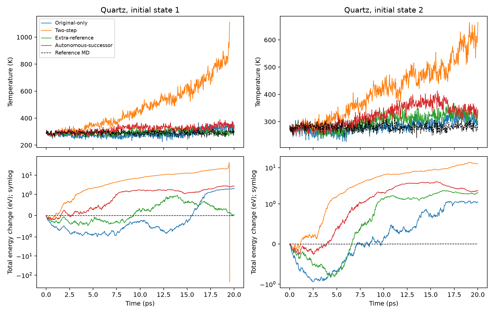
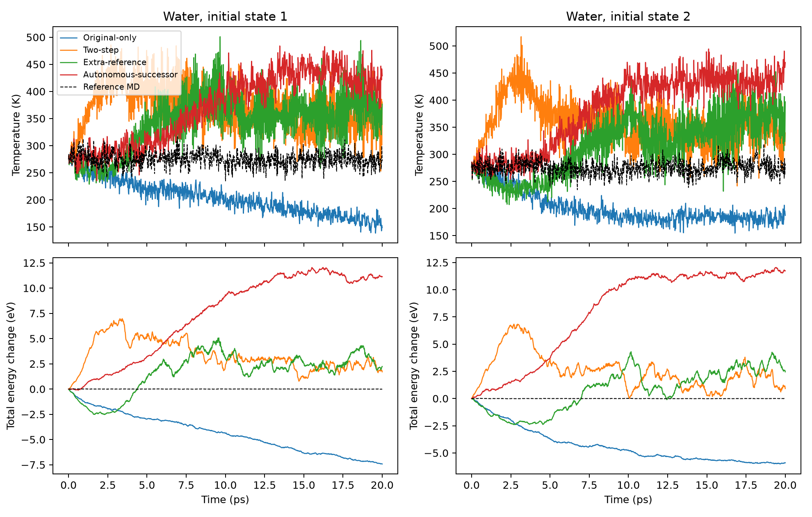
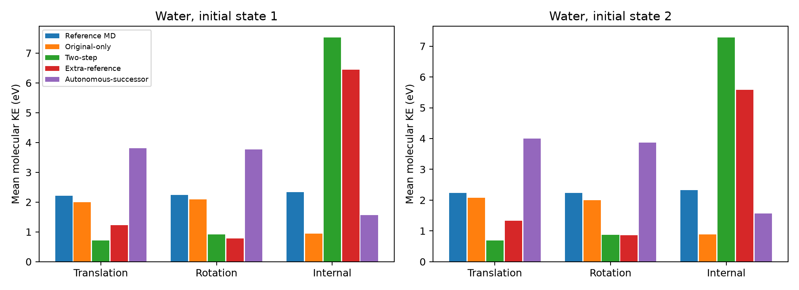

# 自主状态真实后继监督：正式结果

2026-11-09。实现与实验分支：`research/conditional-transition-learning`。
初始实现提交 `01797d8`，启动快照 `734f018`。本文报告实际第 25,000 次更新的
末态，不回退到验证最优或物理效果更好的中途权重。

**结论：本轮没有达到预设的长期动力学改善目标。** 自主状态真实后继监督保留
了较好的终点精度，但没有优于原数据继续训练和等量额外参考数据。尤其 Water
出现明显能量增长和新的运动能量失衡。不能将它报告为有效解决长期分布偏移。

## 完成情况与范围

- Quartz/Water 各四个分支全部完成，各 25,000 更新、400,000 个监督转移目标。
- 两个新增数据分支在每个体系都实际生成了 2,000 + 2,000 个有效标签，无采集
  安全停止或参考求解失败。来自训练源；诊断验证状态库未进入训练。
- 每个模型完成全部 1,250 个验证端点，以及统一的 1/2/4/8 步自主预测。
  Water 多步有一个起点缺少第八步参考，因此四个分支统一使用 1,249 个；
  Quartz 多步均为 1,250 个。单步表仍为完整 1,250 个。
- 16 次预定 NVE 评估中，15 次完成全长；Quartz Two-step 的初态 1 在已保存
  19.53 ps 后的下一次预测触发最小距离安全停止。其失败和轨迹完整保留。
- 所有局部能量评价与 NVE 后处理完成；没有使用独立测试集，没有启动新长 NVT。
  `pipeline_status=completed` 表示分析结束，不能解释为所有轨迹都成功。

模型、目标、优化及数据来源见 [执行说明](IMPLEMENTATION.md) 和
[冻结方案](../../docs/CONDITIONAL_TRANSITION_LEARNING_PROPOSAL.md)。本轮是已有
R3-Opt 权重上的增量学习比较，不是从零训练或多随机种子论文主实验。

## 1. 单步与短程预测

单位：位置 Å，速度 Å/fs。所有数值为固定末态的验证指标。

| 体系 | 分支 | 端点位置 RMSE | 端点速度 RMSE | 8-step 位置 RMSE | 8-step 速度 RMSE |
|---|---|---:|---:|---:|---:|
| Quartz | Original-only | 0.00175378 | 0.000118823 | 0.0190459 | 0.000495421 |
| Quartz | Two-step | 0.00177025 | 0.000122017 | 0.0171444 | 0.000466957 |
| Quartz | Extra-reference | 0.00175208 | 0.000118639 | 0.0186946 | 0.000493928 |
| Quartz | Autonomous-successor | 0.00175275 | 0.000118535 | 0.0187572 | 0.000493907 |
| Water | Original-only | 0.000634957 | 0.000230246 | 0.00818223 | 0.000725416 |
| Water | Two-step | 0.000654656 | 0.000236329 | 0.00790859 | 0.000716380 |
| Water | Extra-reference | 0.000632637 | 0.000229027 | 0.00814952 | 0.000719396 |
| Water | Autonomous-successor | 0.000637237 | 0.000230793 | 0.00821833 | 0.000725491 |

Quartz 第八步是 240 fs，Water 是 40 fs。Two-step 对两体系的八步误差有改善，
但不能据此推断 NVE 更可靠。自主后继分支在端点和短程上没有显示相对
Extra-reference 的明确优势。初始 R3-Opt checkpoint 自带的历史验证 RMSE
分别为 Quartz 0.00177758 / 0.000120075，Water 0.000657063 / 0.000238463；
四个分支的部分改善可以由普通继续优化解释。

## 2. Quartz：20 ps NVE

两初态分别来自验证源 val_07、val_08 的第 0 帧。表内每个值保留独立初态，
不把两条轨迹平均后隐藏差异。能量是相同 BKS 离线计算的未中心化总能量变化。

| 分支 | 总能变化，初态 1/2 (eV) | 平均温度，初态 1/2 (K) | 末态温度，初态 1/2 (K) |
|---|---:|---:|---:|
| Reference MD | −0.00285 / −0.00385 | 290.71 / 280.11 | 见原始曲线 |
| Original-only | +1.991 / +1.127 | 284.52 / 281.84 | 349.52 / 304.07 |
| Two-step | **−221.367（19.53 ps，失败）** / +12.824 | 483.16 / 411.99 | 1110.20 / 664.44 |
| Extra-reference | +0.0365 / +1.996 | 293.42 / 299.58 | 294.70 / 339.73 |
| Autonomous-successor | +2.655 / +2.324 | 317.86 / 322.54 | 346.24 / 331.85 |

除失败轨迹外，Quartz 保存时间为 20.01 ps（667 × 30 fs）。Two-step 初态 1
下一预测的最小原子距离为 0.504 Å，触发原有 0.65 Å 安全规则；保存末态附近的
极端负势能属于结构失真，**不是良好的负向能量漂移或守恒结果**。另一初态虽未
触发安全规则，也明显升温和增能。

Extra-reference 初态 1 的首末能差很小，但初态 2 仍有约 2 eV 增长，不能只报
第一条结果。Autonomous-successor 两初态能量行为均未优于 Original-only。



Quartz 能量轴采用标明的 symlog（线性阈值 1 eV），同时保留 −221 eV 失败和
其余分支的变化。原始线性数值及 KE/PE/总能曲线见 CSV，没有截掉失败末段。

## 3. Water：能量漂移与分子运动分配

两初态均来自验证源 val_04，帧为 0 和 10,000；是同源的两个启动状态，不是
两条独立生成的参考源。其参考 NVE 平均温度约 275 K，应与对应参考比较，
不能把这些 NVE 轨迹全部假定为精确 300 K。

| 分支 | 20 ps 总能变化，初态 1/2 (eV) | 平均温度，初态 1/2 (K) | 末态温度，初态 1/2 (K) |
|---|---:|---:|---:|
| Reference MD | −0.00129 / +0.00285 | 274.98 / 275.28 | 见原始曲线 |
| Original-only | −7.421 / −5.907 | 203.69 / 201.05 | 148.66 / 187.20 |
| Two-step | +1.706 / +0.913 | 370.61 / 358.38 | 380.63 / 339.55 |
| Extra-reference | +2.231 / +2.452 | 342.07 / 314.80 | 376.60 / 396.83 |
| Autonomous-successor | **+11.132 / +11.735** | **370.50 / 382.21** | **428.81 / 469.34** |

以下是每个初态整个评估时间范围的分子动能分量均值，单位 eV；每格为
平动 / 转动 / 内部运动，不是 H/O 原子动能分配。

| 分支 | 初态 1 | 初态 2 |
|---|---:|---:|
| Reference MD | 2.216 / 2.234 / 2.339 | 2.237 / 2.238 / 2.321 |
| Original-only | 1.993 / 2.093 / 0.942 | 2.081 / 2.002 / 0.880 |
| Two-step | 0.713 / 0.914 / 7.523 | 0.694 / 0.874 / 7.280 |
| Extra-reference | 1.227 / 0.776 / 6.442 | 1.326 / 0.864 / 5.582 |
| Autonomous-successor | **3.815 / 3.763 / 1.570** | **4.000 / 3.873 / 1.562** |

自主后继监督改变了误差形态：它没有延续 Two-step 的“内部运动过热、平动与
转动受抑”形态，但转为平动、转动过强且内部运动偏低，同时总能量显著增长。
这不能称为恢复了正确的运动分配。Original-only 也不是合格物理基线：它明显
冷却，内部动能损失严重。所有分支均保留其负结果。




## 4. 局部能量误差：均值改善不等于长期改善

沿用冻结的验证状态库，每个库 256 个状态；真实 MD 后继来自各输入状态本身。
`reference` 是真实参考状态，`r3opt` 是原 R3-Opt 自主访问状态。后者不是本轮
各新模型自己的当前分布，不能据此声称已完全覆盖本轮的新自主分布。

下表为同状态单宏步总能增量误差的 MAE（eV），不是只有符号平均值。

| 体系 | 状态库 | Original-only | Two-step | Extra-reference | Autonomous-successor |
|---|---|---:|---:|---:|---:|
| Quartz | reference | 0.02708 | 0.02300 | 0.02319 | 0.02289 |
| Quartz | r3opt | 0.02360 | 0.02374 | 0.02217 | 0.02225 |
| Water | reference | 0.01171 | 0.01233 | 0.01288 | 0.01026 |
| Water | r3opt | 0.02872 | 0.02643 | 0.02536 | 0.02654 |

Water 自主后继分支在真实状态库上的有符号均值接近零（+0.000102 eV），但
MAE 仍为 0.01026 eV；在旧自主状态库上的均值为 −0.01320 eV。它随后在实际
新自主 NVE 中表现为大幅正向总能增长。因此，真实状态库上的均值更接近零
不能证明已经消除了状态依赖偏差，更不能用该均值线性外推 20 ps 能量。

按温度和时间窗口分层的结果保留在 `local_errors.csv`，逐状态误差保留在
`local_state_errors.csv`。这些状态存在轨迹相关性，不作为 256 个独立实验，
不使用普通 IID 标准误声称显著性。

## 5. 成本、文件与复现

| 体系 | 分支 | 训练墙钟约 (h) | 新标签数 | 标签积分微步 | 神经采集宏步 |
|---|---|---:|---:|---:|---:|
| Quartz | Original-only | 1.14 | 0 | 0 | 0 |
| Quartz | Two-step | 1.90 | 0 | 0 | 0 |
| Quartz | Extra-reference | 1.14 | 4,000 | 120,000 | 0 |
| Quartz | Autonomous-successor | 1.53 | 4,000 | 120,000 | 64,000 |
| Water | Original-only | 1.55 | 0 | 0 | 0 |
| Water | Two-step | 1.94 | 0 | 0 | 0 |
| Water | Extra-reference | 1.70 | 4,000 | 40,000 | 0 |
| Water | Autonomous-successor | 1.48 | 4,000 | 40,000 | 64,000 |

训练墙钟来自最后进度记录，包含训练期间验证、不含后续物理评价；不是独占
GPU 小时或 FLOPs。标签积分微步不含独立的参考正确性核验续跑；生成、核验、
离线势能运行的成本不能都误称为标签积分预算。细分的已记录成本见 `cost.csv`。

各体系的四个分支使用相同 GPU UUID，但**共享负载随时间变化**。相同网络的
短 NVE 实测吞吐差别很大：Quartz 约 98–265 ns/day，Water 约 6.2–31.9
ns/day。这些是运行记录，不能用于推断本轮训练方法改变了架构速度或公平的
加速倍数。终点模型参数始终为 2,357,616；生产前向峰值张量显存约 Quartz
57 MB、Water 104 MB，不等于进程总显存。

服务器根目录：

```
/data1/wyd/research/foundation_mlip_adaptation/experiments/conditional_transition_20261109
```

- `SYSTEM/ARM/step_25000.pt`：正式比较权重；`step_12500.pt`：采集刷新末态。
- `SYSTEM/ARM/history.jsonl`：完整 40 次训练/验证记录。
- `SYSTEM/ARM/collection_roundR/{visited_states,labels}.h5`：状态与其自身后继。
- `SYSTEM/ARM/evaluation/validation_*.json`：端点、多步验证。
- `SYSTEM/ARM/evaluation/nve20ps_R/{trajectory.h5,trajectory.summary.json,physics.csv}`：
  保存的实际轨迹、成功/失败原因、能量温度时间序列。
- `SYSTEM/ARM/evaluation/local_*.csv`：共同冻结状态库的局部转移误差。

仓库同时提供 `prediction.csv`、`physics.csv`、`energy_windows.csv`、
`energy_temperature_curves.csv`、`local_errors.csv`、`local_state_errors.csv`、
`cost.csv`、`results_status.json` 和图表。时间曲线覆盖实际传播范围；Quartz
评估每个保存宏步，Water 约 1,000 个均匀取样点及窗口边界。全分辨率 q/v
继续保存在服务器 HDF5。表内温度、运动分量是该固定采样口径的均值。

重新汇总已有结果，无训练或新轨迹生成：

```bash
cd /data1/wyd/research/foundation_mlip_adaptation/smdp
export PYTHONPATH=.:/data1/wyd/research/foundation_mlip_adaptation/upstream/trajcast-c52f107
export TORCH_FORCE_NO_WEIGHTS_ONLY_LOAD=1 OMP_NUM_THREADS=1 OPENBLAS_NUM_THREADS=1
/data1/wyd/envs/mlip/bin/python -m conditional_transition.summarize
/data1/wyd/envs/mlip/bin/python -m conditional_transition.snapshot
```

## 研究判断与停止范围

1. **当前固定协议不支持自主状态后继监督改善长期动力学的假设。** 端点误差
   接近，局部部分指标改善，但 Quartz 总能行为及 Water 运动统计没有同步改善。
2. **Two-step 也没有通过物理评价。** 更低的短程多步误差伴随严重长期失真，
   不能只突出其八步 RMSE。Quartz 的失败尤其明确。
3. **不能把结果归因于标签被错接到原轨迹未来。** 实际采集从各状态自身求
   后继，并经过训练源参考核验。也不能仅凭这次负结果断言数据聚合原则无效。
4. **尚不能确定唯一误差机制。** 单种子、有限训练初态、固定两轮/深度范围、
   宏步学习目标及模型表示共同限定结果。数据覆盖是否不足或目标是否不够，
   不能从这张对照表单独因果确定。
5. 按冻结协议，**不启动完整 100 ps / 长 NVT，不改模型、不加损失、不自动
   延长采样或训练**。保留所有权重、失败、分布和训练曲线，等待下一次研究决策。
