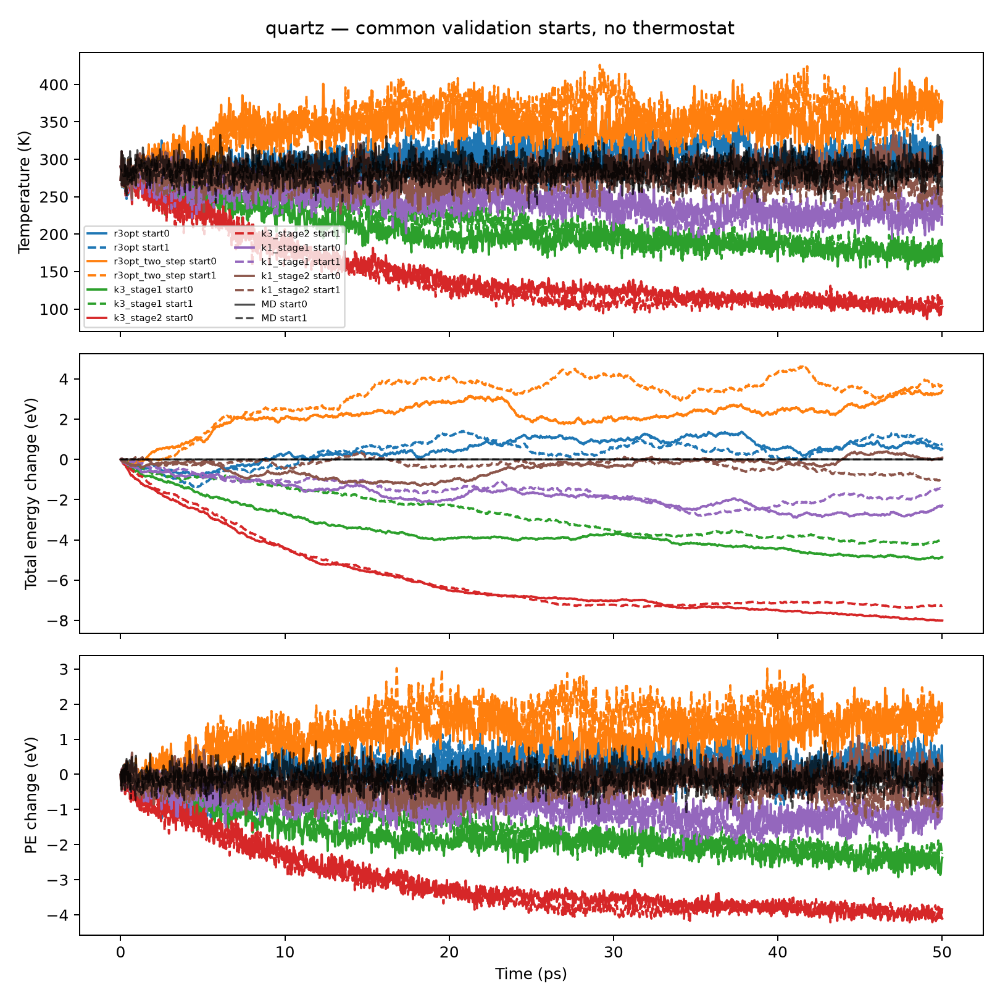
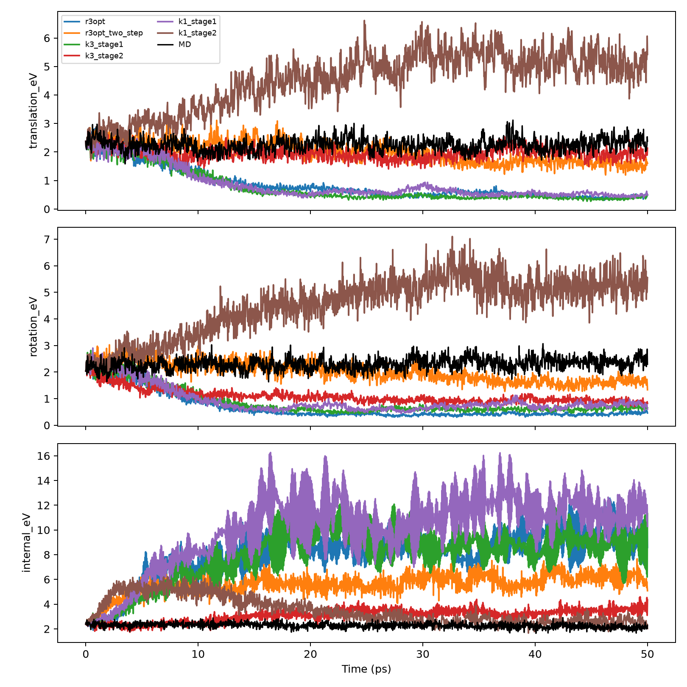

# 冻结模型的长期动力学失真归因：2026-11-09

本轮只做诊断，没有训练 R4、改变网络/损失、调恒温器或重选 checkpoint。
所需 R3-Opt 25k 两步对照以及 K=1 250k + 25k 训练实际都已完成，直接复用。
检查了两体系共 12 个冻结 checkpoint；每个模型从相同的两个验证初态自主运行
50 ps，在 1/5/10/20 ps 汇总，用 20–50 ps 的后半程覆盖局部误差窗口。
已有 100 ps/NVT 只读取结果，不重新生成。正在运行的旧 Water K=1 NVT 未中断。

**主要结论：没有发现已测试的两步标签、周期图或跨步梯度错误；模型已经在真实
参考状态上具有有符号的动力学偏差，自主状态变化又显著改变其方向和幅度。
两步微调能改变运动分配，但未可靠改善长期物理行为；K=3 的必要性没有成立。**

这不证明某个网络层是唯一原因，也不证明所有端点 MSE 训练都必然失败。
它支持把下一轮重点放在训练所得状态转移映射的长期一致性和状态覆盖，并停止
把多模式或更低单步误差本身当成物理成功的证据。

## 1. 资产、协议和数值正确性

全部路径、checkpoint SHA256、选中 epoch/update、原配置、源轨迹划分和历史
轨迹状态见 [assets.json](assets.json)。新代码不修改旧实验。

- A：原 R3-Opt；B：原 R3-Opt 的 25k 两步微调。
- C/D：K=3 的 stage1/stage2；E/F：K=1 的 stage1/stage2。
- K=1/K=3 均完整执行 250k 主训练、25k 微调，验证规则和初态相同。
- K=1 为 2.647M、K=3 为 2.572M 参数；它们是近似容量对照，不是完全相同 FLOPs。
  原 R3-Opt 历史主训练预算也不同，例如 Quartz 停在 231,250 次更新；不能声称
  这些实验是所有因素完全相同的多随机种子因果实验。

两体系分别检查全部 5,000 个正式训练起点的真实两步标签，位置及**绝对速度**
与各自源轨迹一致。初始图的 lattice offset 同时用于真实第二终点，不把连续
位移 minimum-image 化。各 train/val/test 源轨迹互不重叠。

在真实数据和全部六类训练后 checkpoint 上，进一步验证：

| 数值检查 | Quartz | Water |
|---|---:|---:|
| 缓存图与重建图的位置输出最大差 (Å) | 1.91e-6 | 9.54e-7 |
| 整数晶格重映像的位移输出最大差 (Å) | 5.10e-6 | 6.34e-6 |
| 跨步位置梯度中央有限差分最大相对误差 | 3.09e-4 | 3.80e-4 |

第二步确实读模型预测状态，且其损失对第一步 q/v 和 Proposal Head 有非零梯度。
“以预测位置为起点的位移监督”与“真实绝对第二终点监督”数值等价。
两步模型与基线共用原来的归一化尺度和主损失。没有发现这些路径上的确定性
训练实现错误；这不是对所有可能软件问题的无限制排除。

原始 BKS/SPC-Fw 能量、力、质量、时间步及从真实状态推进一个完整宏步均通过
核验，见 `*_reference_verification.json`。另在全部 256 个真实参考探针上校准
fresh MD 与保存端点的差异：

| 连续推进/序列化误差基线 | Quartz | Water |
|---|---:|---:|
| 平均位置 RMSE (Å) | 1.57e-5 | 2.16e-5 |
| 平均速度 RMSE (Å/fs) | 9.78e-7 | 2.49e-6 |
| fresh–stored 总能量均值偏差 (eV) | +4.92e-5 | −2.59e-6 |
| fresh–stored 总能量差标准差 (eV) | 3.62e-4 | 3.60e-4 |

这些非零量保留为诊断精度下限，不称作逐位复现。Quartz 原 LAMMPS Si 质量
28.085 u 与 HDF5 28.0855 u 的差异也保留：积分器使用原始质量，官方指标仍按
HDF5 口径；测得动能差只有约 4e-5 eV，不足以解释 eV 级损失。

## 2. 相同初态下的 Quartz：微调放大了 K=3 耗散，但不是耗散的起点

以下为 **20 ps 末态**，不是之前报告中的 100 ps 平均温度；两个初态来自
val_07/val_08，参考末态温度分别约 295.5/294.0 K。精确采样时刻见 CSV。

| 冻结模型 | 初态 1/2 末态温度 (K) | 初态 1/2 总能变化 (eV) |
|---|---:|---:|
| R3-Opt | 286.8 / 289.9 | +0.452 / +1.234 |
| R3-Opt 两步 | 370.3 / 389.9 | +2.826 / +4.146 |
| K=3 stage1 | 202.6 / 212.4 | −3.915 / −2.269 |
| K=3 stage2 | 131.2 / 126.0 | −6.509 / −6.347 |
| K=1 stage1 | 240.5 / 240.5 | −2.009 / −1.463 |
| K=1 stage2 | 264.2 / 291.1 | −1.083 / −0.370 |

可以明确支持三点。第一，K=3 未微调模型本来就偏冷，不能全部归因于两步训练。
第二，两步训练在 K=3 上加重耗散，在 K=1 上减弱耗散，在 R3-Opt 上转向升温；
没有证据支持某个统一的“错误速度缩放”或“两步训练一律耗散”。第三，K=1 在
这一指标上优于 K=3，当前不能以多模式作为必要机制。

在**完全相同**的真实参考状态和 K=3-stage2 自主状态上，单宏步能量增量误差为：

| 模型 | 真实参考状态 (eV/30 fs) | 共同的 K=3-stage2 状态 (eV/30 fs) |
|---|---:|---:|
| R3-Opt | −0.011821 | −0.005159 |
| R3-Opt 两步 | −0.003117 | +0.002441 |
| K=3 stage1 | −0.012370 | −0.005044 |
| K=3 stage2 | −0.023559 | −0.011440 |
| K=1 stage1 | −0.012036 | −0.004441 |
| K=1 stage2 | −0.005410 | +0.001154 |

表中为四个时间窗口等量抽样的均值，**不是整条轨迹的时间加权漂移**。每窗口
64 状态；窗口长度不同，不能把这些数简单乘以整条轨迹的步数。正确按窗口时长
积分的估计在 `local_time_weighted_energy.csv`，完整能量曲线在 `time_series.csv`。

K=3-stage2 在真实状态上就有约 −0.024 eV/宏步的偏差，明显大于参考误差基线。
其自身轨迹 0–1 ps 的偏差约 −0.0263 eV，20–50 ps 约 −0.00084 eV，后期温度
也降到更低范围。因而并非“离开训练分布后才开始耗散”；原生有符号偏差与
状态依赖性同时存在。另一方面，原 R3-Opt 在真实探针上平均偏负，实际 20 ps
仍可升能，也说明一个真实状态上的平均误差不能单独预测长期结果。

0–1、1–5、5–10、10–20 ps 的 KE/PE/总能变化在 `energy_windows.csv`。
冷却伴随总能降低，并非固定总能在 KE/PE 间重新分配。图中保留全时间过程。

## 3. Water：两步训练改变分配，但多个模式尚未恢复正确运动

相同 val_04 的帧 0 和 10,000 起点，20 ps 参考末态温度约 271.5/282.7 K：

| 模型 | 两起点平均末态 T (K) | 平均总能变化 (eV) | 平动 / 转动 / 内部 KE (eV) |
|---|---:|---:|---:|
| R3-Opt | 391.9 | +3.150 | 0.691 / 0.456 / 8.529 |
| R3-Opt 两步 | 384.6 | +4.991 | 1.943 / 1.958 / 5.594 |
| K=3 stage1 | 386.7 | +3.622 | 0.470 / 0.520 / 8.557 |
| K=3 stage2 | 215.7 | −3.451 | 1.838 / 1.016 / 2.471 |
| K=1 stage1 | 479.7 | +9.557 | 0.572 / 0.691 / 10.581 |
| K=1 stage2 | 536.3 | +15.660 | 4.647 / 5.044 / 3.549 |
| 对应参考 MD | 277.1 | 见逐初态原始表 | 2.346 / 2.384 / 2.112 |

这里平均的是两个初态的瞬时末态值。Water 的两个起点来自**同一条**验证源
轨迹，不能当作两个独立参考数据集。

R3-Opt、K=1 也因两步微调而减少内部动能占优，说明这种改变不是 K=3 专属。
K=3-stage2 的内部动能更接近参考，但同时整体偏冷、转动动能仍不足；不能把
减少内部能量直接解释为恢复了正确的运动统计。K=1 则出现另一种错误：平动与
转动过热，总能大幅增加。因此 K=3 相对 K=1 有某些条件性改善，但没有得到
“多个模式足以恢复正确液体动力学”的证据。

真实参考探针上，相同状态的平均转动 KE 增量误差如下（eV/5 fs）：

| 模型 | 转动增量误差 |
|---|---:|
| R3-Opt | −0.002200 |
| R3-Opt 两步 | +0.000188 |
| K=3 stage1 | −0.001459 |
| K=3 stage2 | −0.006391 |
| K=1 stage1 | −0.001149 |
| K=1 stage2 | +0.000683 |

K=3-stage2 的转动损失在真实状态上已很明确，不是仅在长期偏离后的状态才出现。
原 R3-Opt 自主轨迹 0–1 ps 的转动增量误差约 −0.00501 eV/步；内部误差在
5–20 ps 转为约 +0.00621 eV/步。K=3/K=1 stage1 的后期内部增量误差也明显
放大，但伴随温度和键几何改变，不能把这种相关性直接解释成某个层的因果效应。

共同 K=3-stage2 输入状态上，R3-Opt、K=3-stage1、K=3-stage2 的平均总能增量
误差分别约 +0.00222、+0.00207、−0.00160 eV/步；它们在真实参考状态上又分别
为 −0.00360、−0.00089、−0.00628。说明偏差的方向确实依赖状态与模型，而非
固定的速度增益。所有分量和时间窗口见 `water_local_partition.csv`。

## 4. 条件分层、频谱与辅助诊断

两体系都使用相同诊断框架：每模型自己的自主状态、共享真实状态、共享 K=3
自主状态；每窗口 32 状态/初态，共 64。总计 8,704 个模型—状态评价，原始
q/v、真实后继、预测后继和逐状态能量增量保留在服务器，未进入训练数据。

温度分层、参考几何分位数分层分别在 `local_by_temperature.csv`、
`local_by_geometry.csv`。Water 另有控制温度、最近距离和键长波动后的相关性
`water_energy_motion_associations.csv`。这些是条件关联，不是层级干预或因果证明。
冷却后的 Quartz 与 300 K 参考缺少部分温度范围重叠，不能外推为独立的几何
效应。相同输入的六模型对比可以排除“比较时输入状态不同”这一混杂，但不能
替代多随机种子的架构因果实验。

KE 误差保留了与真实速度相关的线性项和非负二次项，而不只报告 q/v RMSE。
这种区分对方向一致但幅度很小的速度误差重要；同时完整记录 PE 误差，不能
把所有总能变化都归给速度。

窗口 VACF、VDOS overlap 与原始速度功率比见 `spectral_windows.csv`。
它们是非平稳 NVE 的衰减诊断，不是平衡态 VDOS 的替代。Quartz 仅在 30 fs
宏采样可解析的 16.67 THz 带宽内比较；Water 也按匹配的宏采样处理。时间块
及两起点的差异保留，不把连续帧视为独立重复。

时间反演往返也完成，但没有可靠区分能量行为：Quartz K=3-stage2 的往返位置
RMSE 约 0.00140 Å，低于 R3-Opt 的 0.00150 Å，却耗散更严重。因此这个指标
在当前模型上不是能量保真度的可靠排序依据，更不能等价为能量守恒。

## 5. 已有长期结果如何使用

`existing_production_results.csv` 直接引用已完成的历史分析，不重新模拟，也不
用它们选择本轮 checkpoint。两条 Quartz K=3-stage2 100 ps 轨迹的总能下降
约 7.00/8.24 eV，与本轮验证初态上的耗散趋势一致。

Water K=3-stage2 的既有 2.5 ns NVT 均温 298.52 K（参考 300.20 K），但分子
平动/转动/内部 KE 为 2.117/1.313/3.940 eV，参考为 2.459/2.502/2.450 eV。
温度接近不代表分配正确。其扩散系数约 2.87e-10 m²/s，仅为参考
1.88e-9 m²/s 的约 15.3%；虽好于 matched R3-Opt 的近乎停滞结果，仍有约
84.7% 的偏低，而且不能单凭此排除微调、容量及特定轨迹的影响。

这些长轨迹使用测试初态，和本轮统一验证初态的短程对照分开标注，不混为一组
同初态平均。未完成的原长期分析继续按其原流程运行，不作为本轮完成的必要条件。

## 6. 对主要解释的判断

| 解释 | 证据与结论 |
|---|---|
| 两步位置目标写错或第二步未用自身预测 | 数值检查不支持；等价目标及梯度均通过 |
| PBC/边方向/图重建造成数量级错误 | 在已测真实样本和重映像中不支持 |
| 单一质量/时间/速度单位错误 | 原积分器通过；质量元数据微差太小，不足解释当前漂移 |
| 只有分布偏移后才产生偏差 | 不支持；真实状态已有系统性有符号误差 |
| 分布偏移完全不重要 | 不支持；同模型在参考/自主状态上的误差幅度甚至符号不同 |
| 两步微调必然造成冷却 | 不支持；R3-Opt 升温、K=3 更冷、K=1 体系依赖 |
| Quartz K=3 冷却全由微调产生 | 不支持；stage1 已冷，stage2 进一步放大 |
| K=3 的 Water 改善完全来自多模式 | 未成立；其他模型微调也重分配动能，K=3 仍有严重转动偏差 |
| 参数不足是当前主要瓶颈 | 没有证据；容量近似匹配的 K=1/K=3 呈现相反物理偏差 |

## 7. 本轮需要回答的五个问题

**R3-Opt 的主要长期失真来自哪里？**
当前证据指向学习到的状态转移具有状态/运动分量相关的偏差，而非本轮检查出的
目标或图错误。Water 真实状态上已存在转动损失；进入自身访问的状态后内部运动
误差改变并放大。Quartz 的误差也依赖访问状态，不能用真实探针上的平均值
直接推算全程能量漂移。

**SMDP-R 有独立于训练策略的收益吗？**
没有建立跨体系、长期物理可信的独立收益。Water stage1 没有解除运动分配失真；
微调带来的重分配也见于 R3-Opt/K=1。Quartz 中 K=1-stage2 明显优于 K=3-stage2。
可以报告特定 Water 指标改善，但不能把它提升为多模式必要性的结论。

**Quartz 冷却与 Water 分配错误有共同原因吗？**
共同的可观测缺陷是有符号、方向/分量相关的状态转移误差以及由此形成的错误
长期状态分布。它们不是同一固定符号的总能偏差，也尚未定位为同一网络层或
唯一的微观机制。“共享的训练—自主传播不一致”得到支持；“唯一共同机制
已经确定”不受支持。

**下一版优先改网络、训练还是两者？**
优先研究训练目标、状态覆盖及长期验证如何约束实际传播映射；同时重新评估
模式条件化引入的偏置，不默认继续扩容或增加模式。保留有效主干作为对照，
不要把本轮结果直接转成另一个网络或物理校正器。这是研究优先级，不是已经
冻结的新损失/新架构。本轮不启动任何下一版训练。

**还不能确定什么？**
尚不能把模式差异与优化随机性完全分离，也不能证明哪一层、哪一种几何不变量
造成偏差；温度与构型分布仍有混杂；单种物质/单训练 seed 的控制不能外推到
所有体系。时间反演指标也未提供可靠的能量排序。若后续要提出更具体的方法，
应以这些明确缺陷为依据，而不是据此宣称找到了唯一原因。

复现和路径见 [REPRODUCE.md](REPRODUCE.md)。
