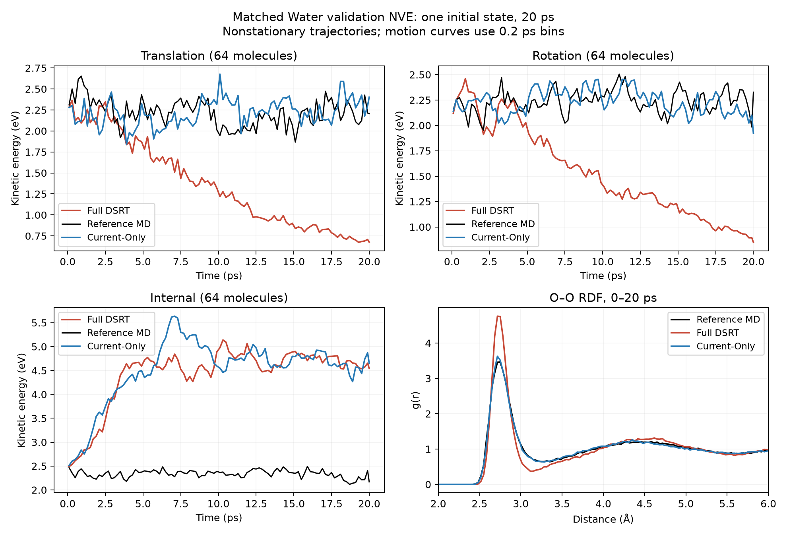

# Completed future-relation control: no demonstrated overall benefit

Reviewed 2026-11-19 (Asia/Shanghai). Current-Only completed on November 17.
Both runs completed all 250,000 optimizer updates / 400 epochs. The checkpoints
were chosen by validation endpoint loss: Full epoch 398, Current-Only epoch 393.
Both retain 2,357,616 parameters, all four propagation blocks, both heads and the
proposal residual. Only the refinement relation condition differs; see
[the frozen protocol](PROTOCOL.md). No further training was launched in response
to this result.

## Endpoint and short autonomous prediction

| Metric | Full DSRT | Current-Only |
|---|---:|---:|
| Independent test position RMSE (Å), 1,000 samples | 0.000409729 | 0.000401363 |
| Independent test velocity RMSE (Å/fs), 1,000 samples | 0.000149673 | 0.000151309 |
| Validation 10 fs position RMSE (Å) | 0.00113081 | 0.00112252 |
| Validation 20 fs position RMSE (Å) | 0.00273064 | 0.00269826 |
| Validation 40 fs position RMSE (Å) | 0.00585153 | 0.00586343 |
| Validation 40 fs velocity RMSE (Å/fs) | 0.000526537 | 0.000508884 |

Removing predicted future relations lowers test position RMSE by 2.04% and raises
velocity RMSE by 1.09%. At 40 fs the position errors differ by 0.20%, while
Current-Only has 3.35% lower velocity RMSE. This is not evidence that future
geometry improves short prediction overall. It is also not a statistical
equivalence test: there is only one training seed, and training GPUs differ.
The multistep sample count is 1,249 valid continuations, distinct from the
1,000-sample independent endpoint test.

## Matched 20 ps validation NVE

Both models start from exactly `water/raw_nve/val_04/trajectory.h5`, frame 0,
and complete 4,000 autonomous 5 fs steps without a thermostat or force calls.
Reference MD below covers the same initial state and 0–20 ps interval.
Completion establishes numerical execution, not physical success.

| 0–20 ps statistic | Reference MD | Full DSRT | Current-Only |
|---|---:|---:|---:|
| Mean temperature (K) | 274.994 | 296.553 | 362.967 |
| Translational KE (eV) | 2.21525 | 1.36561 | 2.22007 |
| Rotational KE (eV) | 2.23611 | 1.53773 | 2.23382 |
| Internal KE (eV) | 2.33788 | 4.41816 | 4.50728 |
| Total KE (eV) | 6.78924 | 7.32150 | 8.96118 |
| O–O RDF RMSE against reference | — | 0.20798 | 0.03092 |
| O–O first peak height | 3.46284 | 4.76152 | 3.62634 |
| O–H RDF RMSE against reference, including intramolecular pairs | — | 0.91279 | 0.87054 |
| H–H RDF RMSE against reference | — | 0.07705 | 0.02992 |
| H sampled VDOS overlap | — | 0.71729 | 0.79927 |
| O sampled VDOS overlap | — | 0.88371 | 0.92963 |

All kinetic energies are totals for the 64 water molecules. Both sampled spectra
use 5 fs spacing (100 THz Nyquist). These are nonstationary NVE comparisons, not
equilibrium VDOS or diffusion validation. The diffusion task correctly declines
an equilibrium coefficient; its successful completion is not a diffusion result.



Current-Only retains reference-like average translation and rotation in this run,
whereas Full increasingly suppresses both. The 5–20 ps means make this visible:

| 5–20 ps mean KE (eV) | Reference MD | Full DSRT | Current-Only |
|---|---:|---:|---:|
| Translation | 2.18394 | 1.12198 | 2.24101 |
| Rotation | 2.24905 | 1.33089 | 2.25480 |
| Internal | 2.34344 | 4.68910 | 4.80566 |

However, Current-Only still develops approximately twice the reference internal
KE, and heats more in total. Full's closer mean temperature coexists with
opposite-signed component errors; it does not establish correct motion partition.
Conversely, Current-Only's better O–O RDF and molecular translation/rotation do
not establish correct full dynamics. The common internal-energy error survives
removal of future conditioning. It therefore cannot be explained solely by that
path. The change in partition is an observed association in this paired run,
not a seed-replicated causal explanation of a particular network operation.

## Missing evidence and execution status

Training, independent endpoint testing, validation multistep testing and the
20 ps trajectories are complete for both models. Motion, RDF and sampled
VACF/VDOS analyses completed. **PE and total-energy drift remain unverified.**
The eight-frame reference check fails at frame 28,571 with an energy discrepancy
of -0.001170599 eV, beyond the frozen 0.001 eV tolerance. Forces pass their check.
Coordinate serialization is a candidate explanation, not a certified resolution.
The tolerance, potential and energy origin were not changed, and the older
two-frame check was not used to bypass this failure.

Consequently the control service returns exit status 1 and `analysis_incomplete`.
That status is a postprocessing verification failure, not a training interruption
or a failed trajectory. Missing PE/total energy is never reported as zero drift.
No new long NVT has been launched on either checkpoint.

## Cost and comparison limits

The paired, prebuilt-graph endpoint timing on the same shared Blackwell GPU gives
medians of 11.943 ms (Full) and 10.050 ms (Current-Only), with four interleaved
100-call repeats per model. Shared-load variability is substantial; this is
indicative, not a precise speedup. It excludes neighbor construction, trajectory
I/O and thermostat work. Both runs use 140,136,960 additional peak tensor bytes
in this measurement.

The two complete 20 ps trajectory throughputs, 8.92 ns/day for Full on L40S and
22.31 ns/day for Current-Only on Blackwell, must not be interpreted as an
architecture speedup. Training used those different shared devices too, although
data, seed, precision, parameter count and optimization budget were matched.

## Research decision from this comparison

This experiment does **not** support adopting predicted future geometry as a
validated improvement to Water dynamics. It also does not establish that
Current-Only solves Water: both have a large internal KE bias, with a worse total
temperature error for Current-Only. The evidence is insufficient to justify more
future-feedback complexity or a long-production campaign framed as success.

Keep both frozen models and the negative result. Any subsequent method proposal
must explain how it addresses the shared motion error and show an advantage over
this simpler, budget-matched control. The present result does not identify a
unique representational or training cause, and no new architecture is declared
on that basis. TrajCast training is a separate reference run, not a prerequisite
for interpreting this completed mechanism comparison.

## Reproduction and source data

From this worktree, regenerate the report and paired figure without training or
rerunning trajectories:

```bash
/data1/wyd/envs/mlip/bin/python scripts/plot_future_relation_control.py
/data1/wyd/envs/mlip/bin/python scripts/export_future_relation_control.py
```

- [Endpoint and completion status](comparison.csv)
- [Full multistep metrics](full/evaluation/val_multistep.json),
  [Current-Only multistep metrics](current_only/evaluation/val_multistep.json)
- [Whole-interval molecular motion](molecular_motion.csv),
  [Prespecified window means](motion_windows.csv)
- [Paired inference timing](current_only/evaluation/paired_inference.json)
- [Failed reference verification](current_only/validation_nve_20ps/analysis/reference_verification.json)
- [Full paths, configurations and selection records](snapshot.json)

Original raw metrics, trajectories, checkpoints, training logs and failures are
preserved. The figure bins existing motion samples at 0.2 ps only for display;
these bins are not independent replicas or new uncertainty estimates.
