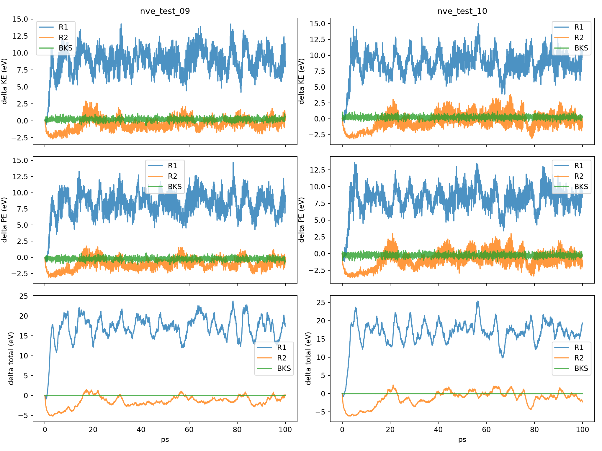
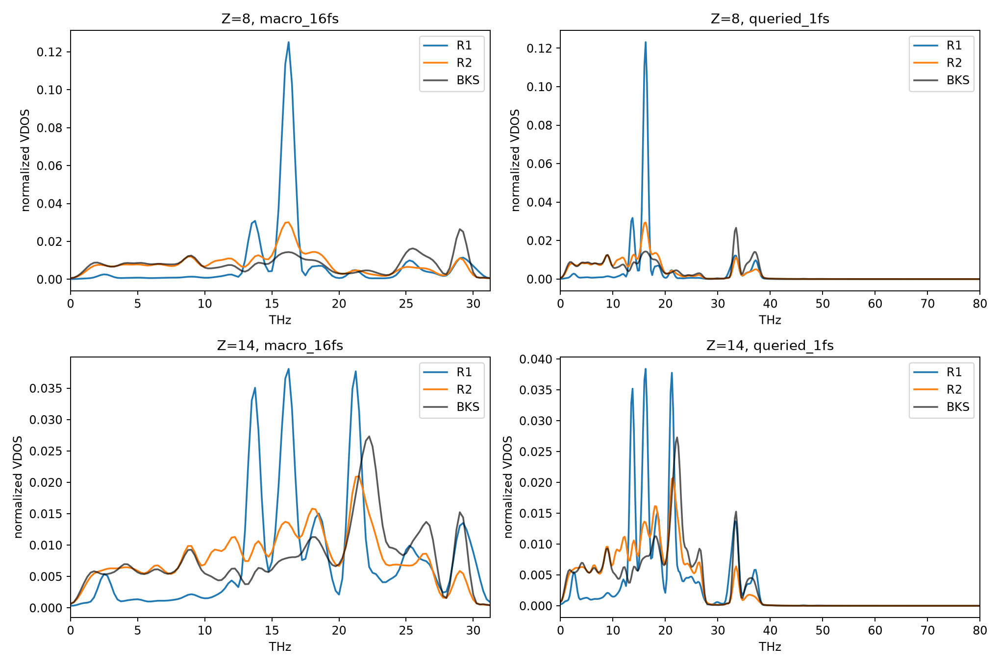
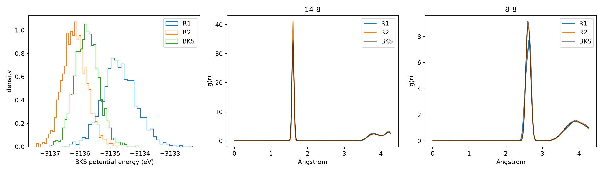
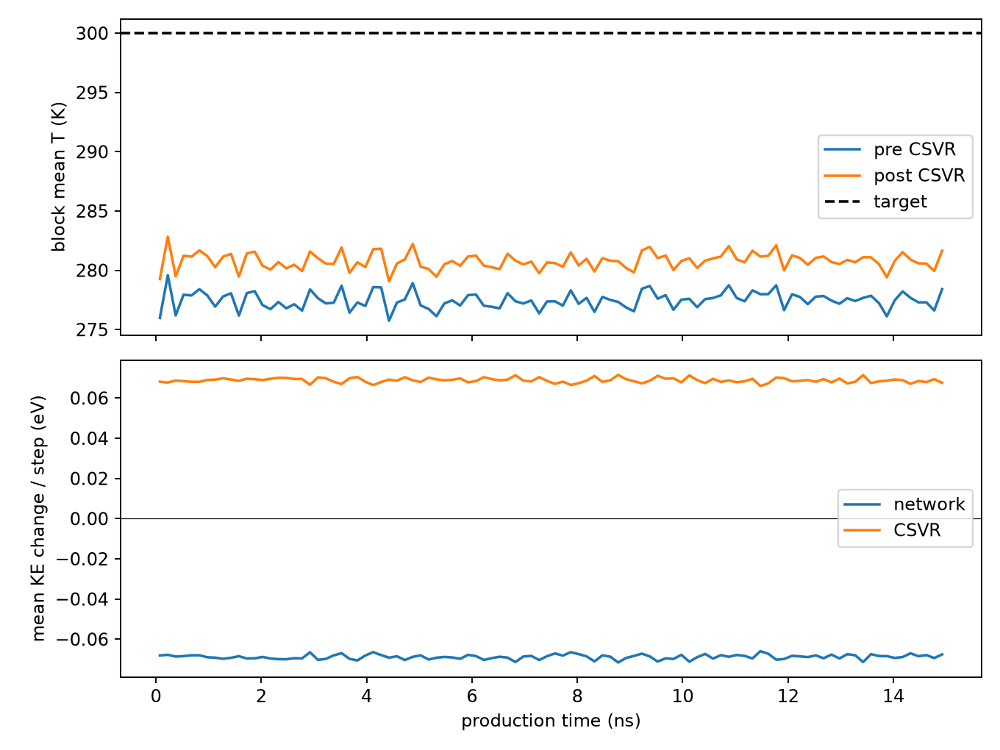
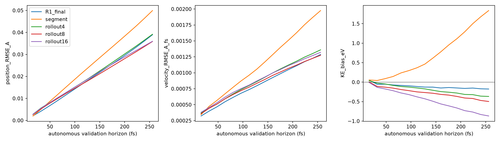
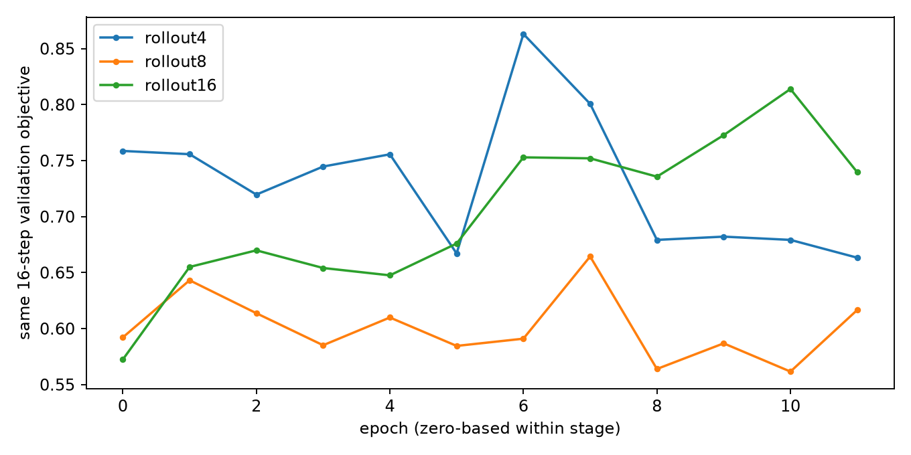

# R2 物理评价补全与误差定位（冻结 checkpoint，未启动 R3）

R1：`/data1/wyd/research/foundation_mlip_adaptation/experiments/motion_modes/quartz16_20261022_r1`
R2：`/data1/wyd/research/foundation_mlip_adaptation/experiments/motion_modes/quartz16_20261022_r2_additive`
本次新增结果：`/data1/wyd/research/foundation_mlip_adaptation/experiments/motion_modes/quartz16_20261022_r2_additive/reanalysis_v1`

原始轨迹、checkpoint、失败日志及服务器旧报告均保留。仅补充离线后处理与冻结模型的验证集推断；没有重新训练或生成新的 MD 轨迹。
两条 100 ps NVE 和 15 ns NVT 生产轨迹均已完成；六项物理后处理也均已完成。原来的 `production_available=0` 是缺失分析被误记为缺失轨迹，并非轨迹生成失败。完整状态见 `run_status.json`。

## 1. 环境修复与评价口径

原 traceback 停在 LAMMPS `CDLL(libpath)`，缺少 `libmpi.so.12`。`readelf` 显示 LAMMPS 依赖该 SONAME；已有 MPICH runtime 位于 `/data1/wyd/envs/lammps-runtime/lib`，此前 R2 后处理启动命令未传递此目录。恢复 `LD_LIBRARY_PATH` 即可；没有安装新 MPI、创建跨实现软链接或修改 BKS。
运行时报告 MPICH 5.0.2、ABI 18:2:6、LAMMPS 20250722。24 个固定 R1/参考构型重新计算的 BKS 势能与原报告最大偏差 1.73e-11 eV；详情见 `bks_runtime_verification.json`。
使用与 R1 相同的 raw LAMMPS BKS/DSF 能量零点及单位换算。能量/温度对照表使用 2000 个均匀生产段样本；RDF 使用相同 512 帧、180 bins；VDOS 使用相同 16.384 ps 不重叠窗口、VACF 与归一化，15 ns 生产段包含 915 个完整谱窗口，尾部不足一窗部分不进入谱估计，与 R1 相同。1 fs 查询轨迹和 16 fs 自主端点分别评价。能量不是对每个 MD 帧重新求值；时间窗边界值在这组相同采样帧之间插值。最小原子间距沿用 R1 的全保存轨迹统计，包含热化段。
JSON 中 `block_mean_std` 是八个时间块均值的标准差，不是独立轨迹置信区间。VDOS 的 block overlap 与整体平均谱 overlap 不是同一估计量。两个 NVE 初态是独立重复，NVT 时间块不是独立模拟重复。

## 2. NVE：平均升温减轻，但不满足能量守恒

| 轨迹 | 方法 | 末端 ΔE / eV | ΔE RMS / eV | ΔE 最小/最大 / eV | 拟合斜率 meV/(atom·ps) |
|---|---|---:|---:|---:|---:|
| nve_test_09 | R1 | 17.42939 | 17.34545 | -0.8745204 / 23.7576 | 0.1389063 |
| nve_test_09 | R2 | 0.1394124 | 2.00322 | -5.181847 / 1.508305 | 0.1125855 |
| nve_test_09 | BKS | 0.00478189 | 0.004111083 | -0.011302 / 0.01260045 | 0.000576153 |
| nve_test_10 | R1 | 19.11145 | 17.11802 | -0.8432465 / 25.41003 | 0.1447016 |
| nve_test_10 | R2 | -2.24998 | 2.348159 | -6.172536 / 2.387569 | 0.2157748 |
| nve_test_10 | BKS | 0.003283002 | 0.005880115 | -0.01788303 / 0.006794087 | -0.0004707605 |

R2 的能量偏离幅度明显小于 R1，但首尾净变化存在耗散和注能相互抵消。尤其 test_10 的全程线性斜率比 R1 更大，不能以首尾接近或平均温度降低声称 NVE 守恒改善到合格。

| 轨迹 | 模型 | 时间窗 ps | 平均温度 K | ΔKE eV | ΔPE eV | ΔE eV |
|---|---|---|---:|---:|---:|---:|
| nve_test_09 | R1 | 0–1 | 276.4967 | 1.06539 | -0.3326535 | 0.7327367 |
| nve_test_09 | R1 | 1–5 | 571.7109 | 5.586061 | 5.150412 | 10.73647 |
| nve_test_09 | R1 | 5–20 | 715.5137 | -0.7465116 | 1.600097 | 0.8535852 |
| nve_test_09 | R1 | 20–100 | 709.759 | 2.858012 | 2.248582 | 5.106594 |
| nve_test_09 | R2 | 0–1 | 223.7178 | -1.730729 | -2.3355 | -4.066229 |
| nve_test_09 | R2 | 1–5 | 174.7568 | -0.07450764 | -0.3439737 | -0.4184814 |
| nve_test_09 | R2 | 5–20 | 240.8433 | 2.582407 | 2.273522 | 4.855929 |
| nve_test_09 | R2 | 20–100 | 261.1732 | 0.1635315 | -0.3953373 | -0.2318058 |
| nve_test_10 | R1 | 0–1 | 293.8413 | 0.8918496 | -0.8358686 | 0.055981 |
| nve_test_10 | R1 | 1–5 | 572.7402 | 11.07745 | 9.623398 | 20.70085 |
| nve_test_10 | R1 | 5–20 | 719.3174 | -4.773707 | -2.6358 | -7.409507 |
| nve_test_10 | R1 | 20–100 | 717.7437 | 3.032502 | 2.731622 | 5.764125 |
| nve_test_10 | R2 | 0–1 | 233.705 | -2.094203 | -2.463863 | -4.558066 |
| nve_test_10 | R2 | 1–5 | 164.9764 | -0.4493529 | -0.9766966 | -1.426049 |
| nve_test_10 | R2 | 5–20 | 220.1107 | 4.099403 | 2.525114 | 6.624517 |
| nve_test_10 | R2 | 20–100 | 291.0799 | -2.060173 | -0.8302085 | -2.890382 |

前 1 ps 两条轨迹同时损失动能和势能，总能量分别下降约 4.07、4.56 eV；不是动能转移到势能。采样能量最小值分别在 3.344、3.248 ps，总能量最高值分别在 17.248、21.200 ps。5–20 ps 又同时增加动能和势能，总能量增加约 4.86、6.62 eV；不是单纯势能释放。20–100 ps 继续出现不规则交换与净变化。证据支持状态依赖的非物理耗散/注能，而非单一恒定漂移；仅凭现有轨迹不能唯一归因到某层网络。
NVE 的 Si/O 谱并没有随能量偏离缩小而改善：两条 R2 的 16 fs O overlap 为约 0.688/0.661（R1 0.734/0.730），Si 为约 0.715/0.719（R1 0.795/0.796）。因此“能量偏差小一些”和“动力学更真实”必须分开判断。完整 RDF、温度和能量逐项表见 `COMPARISON.md`。

## 3. NVT：完整生产段对照

| 指标 | BKS | R1 | R2 | R2 − BKS |
|---|---:|---:|---:|---:|
| 温度均值 K | 299.184 | 361.3444 | 280.7478 | -18.43619 |
| 势能均值 eV | -3135.773 | -3134.682 | -3136.164 | -0.3906676 |
| 势能标准差 eV | 0.4010646 | 0.5775837 | 0.403189 | 0.002124452 |
| O 总动能 eV | 4.150435 | 6.05361 | 3.968541 | -0.1818934 |
| Si 总动能 eV | 2.075842 | 1.466278 | 1.874062 | -0.2017796 |
| macro_16fs O VDOS overlap | 1 | 0.4496718 | 0.8109382 | -0.1890618 |
| macro_16fs Si VDOS overlap | 1 | 0.6281193 | 0.831344 | -0.168656 |
| queried_1fs O VDOS overlap | 1 | 0.4577341 | 0.8188459 | -0.1811541 |
| queried_1fs Si VDOS overlap | 1 | 0.6196627 | 0.8339806 | -0.1660194 |
| 14-8 RDF RMSE | 0 | 0.2401528 | 0.570315 | 0.570315 |
| 8-8 RDF RMSE | 0 | 0.3096488 | 0.05685032 | 0.05685032 |

势能 Wasserstein 距离：R1 1.090768 eV，R2 0.3906676 eV。峰位置、峰高、块波动和完整差值见 `COMPARISON.md` 与 `nvt_analysis/metrics.json`。
16 fs 的 Nyquist 上限为 31.25 THz；1 fs 输出的准确性只由其与同采样率 BKS 谱的比较支持，不能由输出频率推断。密集输出包括宏步终点恒温 kick，段内查询不是独立积分得到的真实微步。

| 谱 | 元素 | R2 全平均谱 overlap | 配对块 overlap 均值 | 配对块 overlap 标准差 | BKS 奇偶块平均谱 overlap |
|---|---|---:|---:|---:|---:|
| macro_16fs | 8 | 0.8109382 | 0.8049743 | 0.01611992 | 0.9987518 |
| macro_16fs | 14 | 0.831344 | 0.8245051 | 0.01113664 | 0.9985316 |
| queried_1fs | 8 | 0.8188459 | 0.8109586 | 0.01479213 | 0.998613 |
| queried_1fs | 14 | 0.8339806 | 0.8261408 | 0.01125032 | 0.9985 |

全平均谱的剩余误差远大于 BKS 奇偶时间块之间的差异，不能用有限采样噪声解释。两种采样率下 NVT 谱相对 R1 均明显改善，但 NVE 谱退步；这说明在恒温补偿下取得更好谱形，并不代表无恒温自主动力学已经正确。
RDF 也不是全面改善：NVT O–O RMSE 从约 0.310 降至 0.0569，而 Si–O 从约 0.240 升至 0.570；后者第一峰高于参考约 18.1%。不能用 O–O 的改善代表全部局部结构。

## 4. 为什么 CSVR 后仍只有约 280.8 K

全生产段逐步统计（937,500 步；与上述 2000 帧统计有轻微采样差异）：pre 温度 277.4715 K，post 温度 280.7778 K。网络每步 ΔKE = −0.06880678 eV，CSVR 每步 ΔKE = +0.06880606 eV。O 分别为 −0.04667084/+0.04667053 eV，Si 为 −0.02213594/+0.02213553 eV。
保存的 alpha 满足 T_post = alpha² T_pre（最大差 6.7e-5 K）。按原随机种子重放包括热化段的全部 1,031,250 步，alpha 最大差 6.52e-8，与 float32 存储精度相容。随机更新的有限样本均值偏差也被完整重现，未发现 CSVR 实现错误。见 `csvr_replay.json`。
令 c=exp(−16/100)，d=平均(T_pre[n]−T_post[n−1])，则稳态均值关系为 μ_post=300+c·d/(1−c)+ε/(1−c)。忽略有限随机样本 ε 时得到 280.9448 K；加入测得 ε=−0.0247164 K 后得到实际约 280.7778 K。网络持续耗散使有限耦合恒温器在低于目标的状态补偿它；这不是正确平衡分布，也不应通过升高目标温度掩盖。
元素动能分配比 R1 更接近参考，但 Si 与 O 仍均偏低且比例不完全正确。这里比较的是相同速度/质心处理下的分元素总动能，不把每个元素独立强制到 300 K。

## 5. 冻结阶段 checkpoint 的统一验证

全部 1,250 个验证起点用于单步；其中 1,245 个有完整 256 fs 参考窗口用于多步。仅验证集、无优化器、无测试集选择、没有生成新的物理轨迹。表中误差单位分别为 Å、Å/fs。

| 阶段 | 1-step q RMSE | 2-step q RMSE | 16-step q RMSE | 16-step v RMSE | 256 fs KE 偏差 eV | 段内运动学 RMSE Å/fs |
|---|---:|---:|---:|---:|---:|---:|
| R1_final | 0.002066994 | 0.004173092 | 0.03893791 | 0.001286872 | -0.1772687 | 0.0001126776 |
| segment | 0.002016381 | 0.005055903 | 0.04992153 | 0.001975533 | 1.836472 | 2.177793e-05 |
| rollout4 | 0.002818502 | 0.005632725 | 0.03916157 | 0.001359981 | -0.3675056 | 0.0001053827 |
| rollout8 | 0.002639497 | 0.005176439 | 0.03587154 | 0.001274955 | -0.4969488 | 0.0001019621 |
| rollout16 | 0.002777217 | 0.005509411 | 0.0359694 | 0.00132068 | -0.868947 | 9.955629e-05 |

参考段内位置差分—速度 RMSE 为 8.697e-6 Å/fs。相邻段导数跳变量的参考 RMS 为 4.8261e-4 Å/fs，R1 为 5.5733e-4、R2 为 4.7721e-4；真实加速度也会造成有限差分跳变，因此 RMS 接近参考不等于逐点导数误差消失。详细指标保存在阶段 JSON/CSV。
短期精度与运动学一致性从 rollout4 阶段就开始付出代价；但 256 fs 预测相对 segment 明显改善，所以不能说长 rollout 完全无效。rollout8 是三个 rollout 阶段中统一验证目标最好的 checkpoint。进入 rollout16 后没有进一步改善，且负动能偏差加重。

| 阶段 | 最优 epoch（0-based） | 最优同口径 16-step validation loss | 最后 epoch loss |
|---|---:|---:|---:|
| rollout4 | 11 | 0.6633026 | 0.6633026 |
| rollout8 | 10 | 0.5615938 | 0.6165566 |
| rollout16 | 0 | 0.5723756 | 0.739662 |

`train_quartz.py` 在阶段切换时重置 best，并最终复制 `best_rollout16.pt`，而不是所有阶段中的最优 checkpoint。这是模型选择范围的限制，不是本次分析修改了模型。segment 的训练验证 loss 不含相同多步项，不应拿它与 rollout loss 的绝对值直接比较。此轮没有改选模型重跑 NVE/NVT，故不能声称 rollout8 会有更好的 100 ps 或 15 ns 物理结果。
还需注意实际训练的梯度范围：pushforward 只对最后两个 segment 保留梯度，并非 16 步完整反传。`rollout_species_kinetic` 对所有已预测时刻取均值；其中可直接反传的时刻占比由 rollout4 的 2/3 降到 rollout8 的 2/7，再到 rollout16 的 2/15。VACF 全时刻配对中至少一端可反传的比例分别为 8/9、24/49、56/225。已经 detach 的前缀仍进入 loss 数值，但不产生梯度；因此延长展开并不自动加强这些统计目标的有效训练。上述是代码可证的监督范围变化，不等于已经量化其对耗散的因果贡献，本轮不更改权重或梯度方案。

## 6. 模式是否互补；Recurrent 是否导致错误

R1 删除 Mode 1–3 最终输出几乎不影响误差。R2 删除任一模式最终贡献都会显著增加误差：验证集 q RMSE 从 0.002777 Å 分别升至 0.008868/0.015575/0.013105/0.027341 Å；速度亦全部变差。这里仅删除最终 decoder 项，保持上游交互不变，不等同于删掉整个模式重新训练或证明物理可辨识性。
R2 位移 signed projection 约 9.77/18.53/18.33/53.36%，速度约 6.60/17.20/11.99/64.21%。Mode 4 仍占主导，但不再是唯一有用输出。速度贡献的两两余弦约 −0.051 到 0.351，并非四份简单重复；这些指标支持多项输出共同参与预测，但不能证明它们承担了不同的物理时间尺度任务。
输入验证状态上的 Recurrent 路由均值约 0.947/0.99994/0.736/0.691。Mode 3 的跨模式注意力约 99.993% 指向 Mode 4，说明交互仍高度集中。按固定预测步分别测量路由与动能增量误差相关性，最终 256 fs 的四个 Pearson r 约 0.039/0.004/0.016/−0.013，未发现 Recurrent 占优导致耗散的证据；尤其路由变化范围很小，不能用低相关性排除影响，也不能用阶段间共变推断因果。逐步/逐元素数值见 `stages/*.json`。

## 7. 研究判断与停止点

R2 缩小了 NVE 的能量偏离幅度，且多模式输出确实参与了预测；但是早期双重能量损失、随后注能以及 NVE 频谱退步表明动力学仍不可信。NVT 温度、元素分配和势能分布的改善不等同于正确 NVE；完整频谱与 RDF 数值如上，必须逐项判断。
下一轮最值得优先处理的是已实测的自主速度/能量变化偏差：长展开从 segment 的注能变成 rollout8/16 的耗散，最终模型在 NVT 每步持续抽走动能。具体应优先审视长展开目标与实际截断梯度的对应关系，并避免末阶段强制覆盖更好的跨阶段验证 checkpoint，而不是继续增加 rollout 长度或损失项。这里提出的是误差优先级，不添加损失、网络或新算法。尚无依据优先把问题归咎于恒温器或 Recurrent 架构本身。
R2 生产吞吐约 104.91 ns/day，R1 163.25 ns/day，来自原始运行计时且包括查询与 I/O；未重新跑速度实验，硬件虽同为 L40S但负载条件未严格隔离，不能把差额完全归因于某个模块。
本轮到此停止：未启动 R3、未改传播器/训练目标、未调恒温参数、未删除不理想轨迹。

## 复现与文件

分析与重跑命令见 `REANALYSIS.md`。所有服务器原始 checkpoint 保留；阶段权重路径在 `stages/*.json`。公开仓库只保存代码、汇总 JSON 与关键图表，不上传 HDF5、checkpoint 或大体积逐样本日志。
